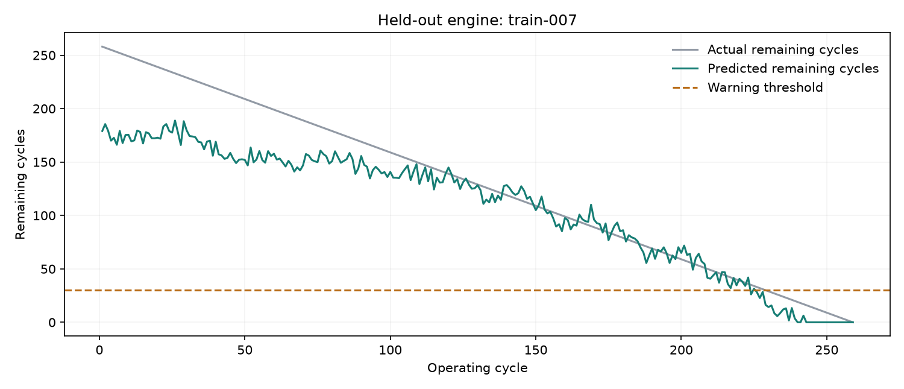

# Model results

Selected model: **ridge** (lowest validation MAE).

MAE and RMSE are measured in operating cycles. Lower is better.
Warning precision and recall use a fixed threshold of 30 remaining cycles.

| Evaluation | Model | MAE | RMSE | Warning precision | Warning recall |
| --- | --- | ---: | ---: | ---: | ---: |
| validation | median_baseline | 56.22 | 67.083 | 0.0 | 0.0 |
| validation | ridge | 26.727 | 34.582 | 0.91 | 0.698 |
| validation | random_forest | 28.079 | 38.074 | 0.825 | 0.816 |
| test | median_baseline | 56.292 | 68.039 | 0.0 | 0.0 |
| test | ridge | 28.775 | 38.488 | 0.835 | 0.637 |
| test | random_forest | 27.774 | 40.422 | 0.895 | 0.877 |
| official_last_cycle | median_baseline | 38.74 | 49.275 | 0.0 | 0.0 |
| official_last_cycle | ridge | 25.65 | 31.3 | 0.846 | 0.44 |
| official_last_cycle | random_forest | 22.283 | 32.842 | 0.944 | 0.68 |

## How to read these numbers

- Train, validation and test contain 60, 20 and 20 separate run-to-failure engines.
- The official evaluation uses only the last observed cycle of each of 100 additional engines.
- Full-history scores weight each cycle equally, so longer histories have more influence.
- No target capping is used. These scores are not directly comparable to capped-RUL benchmarks.
- Predictions are clipped at zero. Warning scores measure individual cycles, not independent events.
- Model selection uses validation only; test results are descriptive, not tuning feedback.
- This is simulated data under one operating condition. It does not establish real-machine accuracy.

## Warnings on the 20 held-out full histories

A timely warning is one raised while 1–30 cycles remain. A warning with more than 30 cycles remaining is counted as an early false warning.

```json
{
  "engines": 20,
  "engines_without_timely_warning": 0,
  "engines_with_early_false_warning": 6,
  "median_timely_warning_cycles": 20.0
}
```

The median warning time excludes engines without a timely warning; read it alongside the missed-engine count.



The example is the alphabetically first held-out engine, chosen without inspecting its prediction error.

Run: `fb3c87b31354`. Library version: scikit-learn `1.9.1`.
Dataset archive SHA-256: `74bef434a34db25c7bf72e668ea4cd52afe5f2cf8e44367c55a82bfd91a5a34f`.
